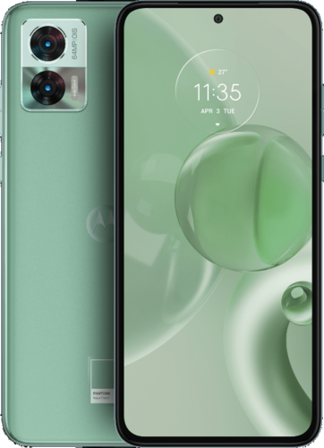
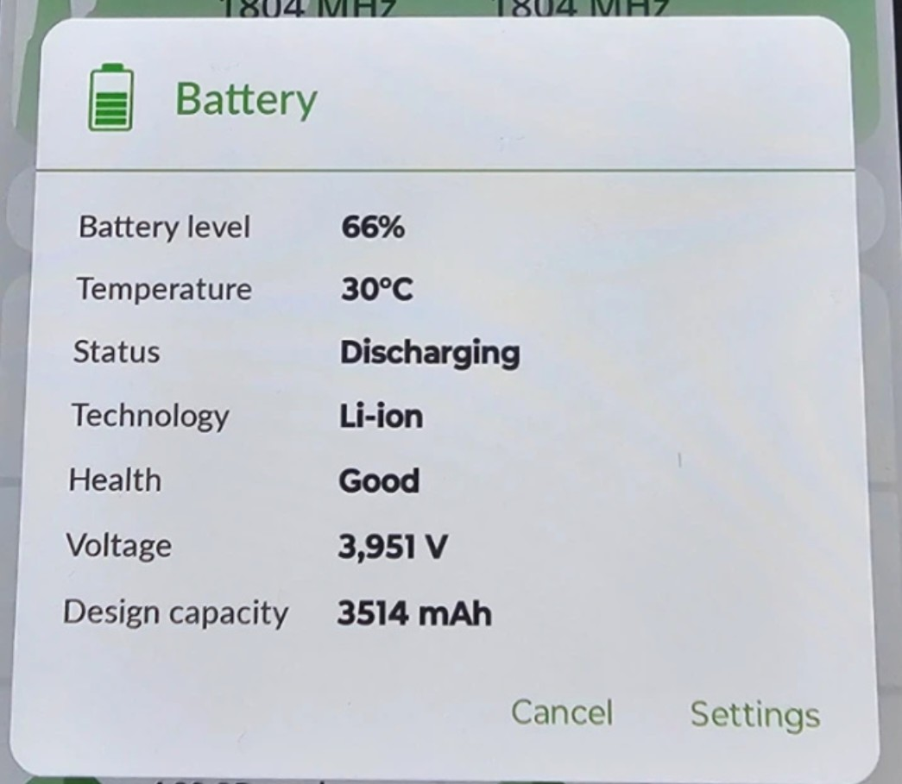
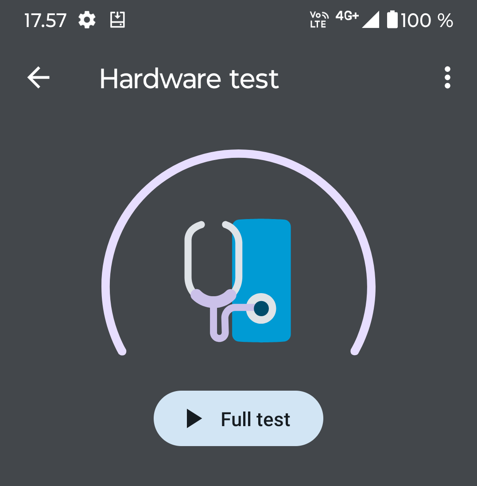
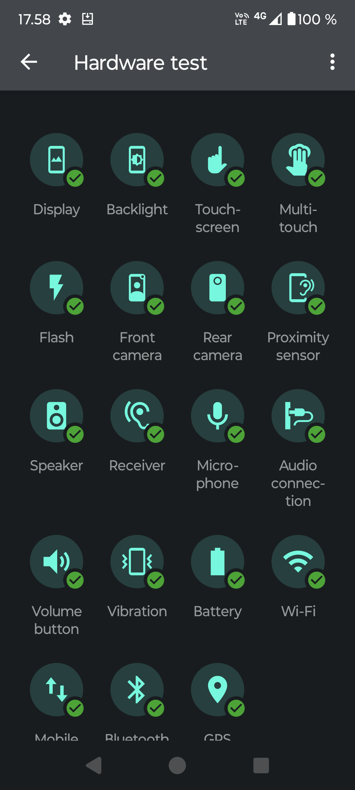
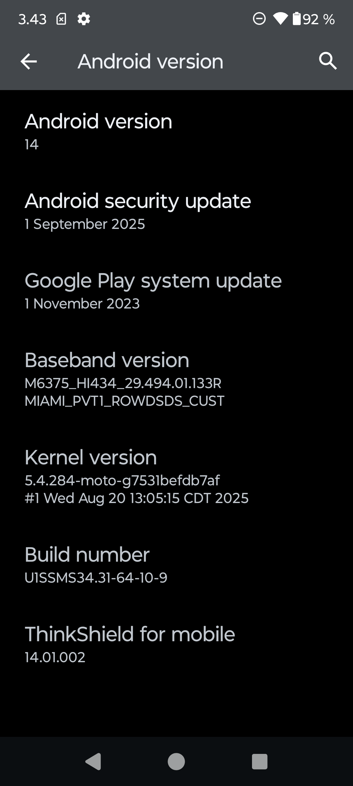

# Ubuntu Touch porting experiment
An experiment to port Ubuntu Touch operating system for Motorola Edge 30 Neo.  

> [!CAUTION]
> Installing or developing custom ROMs carries significant risks, including permanent device damage, security vulnerabilities, and warranty voidance. Unlocking the bootloader typically voids the manufacturer’s warranty. Proceed at your own risk! 

## Preface  

  

Purpose of this experiment is to have one more device for minimizing data collection by tech giants, preventing surveillance and tracking, and enhancing security against cyber threats. [https://keepandroidopen.org/](https://keepandroidopen.org/) 

At the start of this [Ubuntu Touch](https://www.ubuntu-touch.io/) porting project I have no earlier experience of developing operating systems for mobile phones. My earlier experience is purely flashing different operating systems including [crDroid](https://crdroid.net/), [LineageOS](https://lineageos.org/) (and CyanogenMod as it was named earlier), [Sailfish OS](https://sailfishos.org/) and of course [AOSP based operating systems (read Android)](https://source.android.com/docs/setup) on Android phones back and forth with some little tweaking of those. I think that getting SSH up and running and getting one Mullvad VPN profile working on a Sailfish OS doesn't count as so real OS development.  

## Software tools
This documentation has been started using Fedora 44. The development itself might be carried out using Ubuntu as recommended.  
> [!NOTE]
> There might be software installed earlier on my systems that are not mentioned here. I'll try to come up with a full list of used software for the development.

### ADB install
Install ADB (Andoid Debug Bridge) on RHEL- (Fedora) and Debian based (Ubuntu) Linux from package manager.  

Ubuntu/Debian/Mint:
```bash
sudo apt install adb fastboot
```
Fedora/RHEL/CentOS:
```bash
sudo dnf install android-tools
```
### ADB / fastboot guide on LineageOS Wiki
[Using ADB fastboot](https://wiki.lineageos.org/adb_fastboot_guide)

## Hardware  

[Motorola Edge 30 Neo (miami)](https://www.gsmarena.com/motorola_edge_30_neo-11635.php) was chosen as I have interest also for developing [Sailfish OS](https://forum.sailfishos.org/t/motorola-edge-30-neo-port-from-verdanditeam/29547). At the moment writing this there is an active development for it by [VerdandiTeam](https://verdanditeam.com/device/miami).  

  
Motorola Edge 30 Neo image from:  

[LineageOS Wiki](https://wiki.lineageos.org/devices/miami/)  
  
I sourced my hardware from a Lithuanian private seller on [Vinted](https://www.vinted.com/). When asked the seller kindly provided me a screenshot of the battery tab of DevCheck app to determine the battery wear.  

  

The picture suggests battery designed capacity is around 87% from original design capacity 4020 mAh. At the moment I haven't figured out if it is possible to extract battery charge cycles from this phone model.

After paying the product (90€ + the platform service fee 5,20€) it took 7 days to get the phone on my hands in Finland. 


## Inspecting and testing the hardware

Externally the phone matched the description of selling ad. First there was a problem with usb-c cable not attaching firmly enough to the phone for charging. This was resolved scraping lint and other dirt from the charging port with self made non-conductive plastic tool. Be careful not to bend the usb-c port when cleaning it. Use tool flexible enough.

The first time I started the aquired phone it booted straight in to Android. No additional installation was necessary for this. There wasn't any user accounts and no password defined.  


### Testing the hardware using manufacturer's own hardware test  
  

It took few minutes to go through the `Full test`  
  
    
The test results

### Checking the installed Android version   


## Enabling the Developer options menu and switching on USB debugging and OEM unlocking

Enable USB debugging tapping about 7 times the `Build number` in `Android version` screen. This results notification "You're now a developer" or something similar. After this search developer options menu from the phone setting. In this menu enable `USB debugging` and `OEM unlocking` options. The latter is needed for flashing a ROM to the device.  

### Using ADB (Android Debug Bridge)

Check that the phone is connected by running:  
```bash
adb devices
```
This should print the ID of the attached device:  

```bash
List of devices attached
ZY22H23Q6X	device
```


### Checking the battery condition using adb

The battery status percentage can be calculated by dividing `charge_full` by `charge_full_design` * 10.  

```bash
adb shell cat /sys/class/power_supply/battery/charge_full
```
```bash
3694000
```
```bash
adb shell cat /sys/class/power_supply/battery/charge_full_design
```
```bash
4020000
```

`(3694000 / 4020000) * 10 = 91,89` is approximately `92 %` of the original capacity of this battery.  

If the phone hasn't been used in a while the full battery charge capacity can grow a bit when draining battery empty and charging it back to 100% few times. This is called battery refreshing.

The battery full charge capacity has fluctuated a bit between charges. I've recorded differing results (3694 mAh ~ 91,9% -> 3514 mAh ~ 87,4%). We'll see if this settles after after some more cycles.

### Reboot into Bootloader menu

The following command should take you to Bootloader menu by rebooting.   
```bash
adb reboot bootloader
```  
There is usually also a key press combination that takes you to the same menu.  

This menu can be used for OEM unlocking.  

### Checking that the Fastboot mode works  
```bash
fastboot devices
```
The print out is similar using the `adb` command earlier.  
```bash
ZY22H23Q6X	 fastboot
```
Rebooting to back to installed operating system can be done using:
```bash
fastboot reboot
```

```bash
Rebooting                                          OKAY [  0.000s]
Finished. Total time: 0.151s
```


> [!WARNING]
> THE FOLLOWING IS BEING TESTED AT THE MOMENT!!!

## Setting up the build environment

Seems that the steps for setting up the build environment on Ubuntu 24.04 LTS using the [UBports documentation](https://docs.ubports.com/en/latest/porting/introduction/Setting_up.html) is bit problematic. Documentation might be bit outdated and / or incomplete. 

[The fix](#fix-setting-up-development-environment) for this is still being tested.  

This doesn't give any output if `python3` is installed:  
  
```bash
python -V
```

Also the following gives some errors.
  
```bash
sudo apt install git gnupg flex bison gperf build-essential \
zip bzr curl libc6-dev libncurses5-dev:i386 x11proto-core-dev \
libx11-dev:i386 libreadline6-dev:i386 libgl1-mesa-glx:i386 \
libgl1-mesa-dev g++-multilib mingw-w64-i686-dev tofrodos \
python-markdown libxml2-utils xsltproc zlib1g-dev:i386 schedtool \
repo liblz4-tool bc lzop imagemagick libncurses5 rsync
```
### Errors
  
```bash
E: Package 'libgl1-mesa-glx:i386' has no installation candidates
E: Unable to locate package libncurses5
E: Package 'python2' has no installation candidates
```   
## Fix setting up development environment

| Removed / Changed | Replacement | Why |
|---|---|---|
| `libgl1-mesa-glx:i386` | `libgl1:i386`, `libglx-mesa0:i386` | Obsolete since 23.10; split into these two |
| `libncurses5-dev:i386` | `libncurses-dev:i386` | Avoids the "Note" (same package, cleaner) |
| `libreadline6-dev:i386` | `libreadline-dev:i386` | Avoids the "Note" (same package, cleaner) |
| `libncurses5` | `libncurses6` | Runtime lib 5 was removed from 24.04 repos |
| `x11proto-core-dev` | *(removed)* | No longer exists in 22.04+ |
| `python2` | *(removed)* | Not in 22.04+ repos; `python-is-python3` handles the python symlink |
| `mingw-w64-i686-dev` | *(kept)* | Still valid on 24.04 |  

> [!NOTE]
> Brave search AI: "If a specific Halium build script hard-requires python2 (unlikely with current Halium 9/10), you'd need to grab the .deb from the focal archive, but you should hit that problem (if at all) only during the build, not during setup."

All of the fixes above regarding to the setting up development environment and the rest of the steps in docs are included in the script [setup_dev_env_ubuntu_2204.sh](setup_dev_env_ubuntu_2204.sh).


 

  
